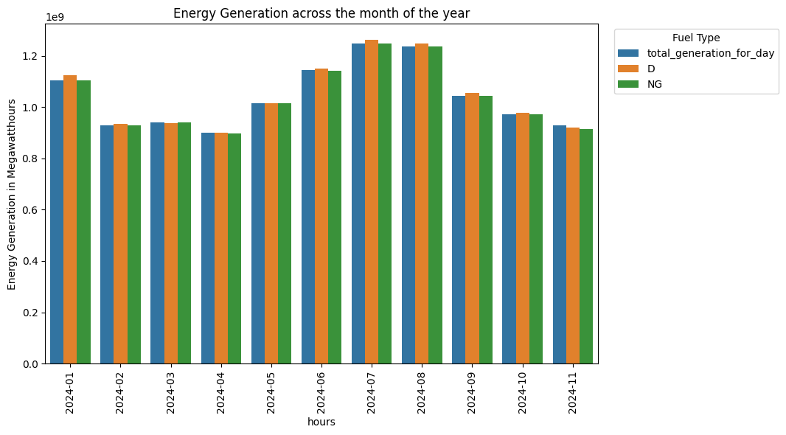
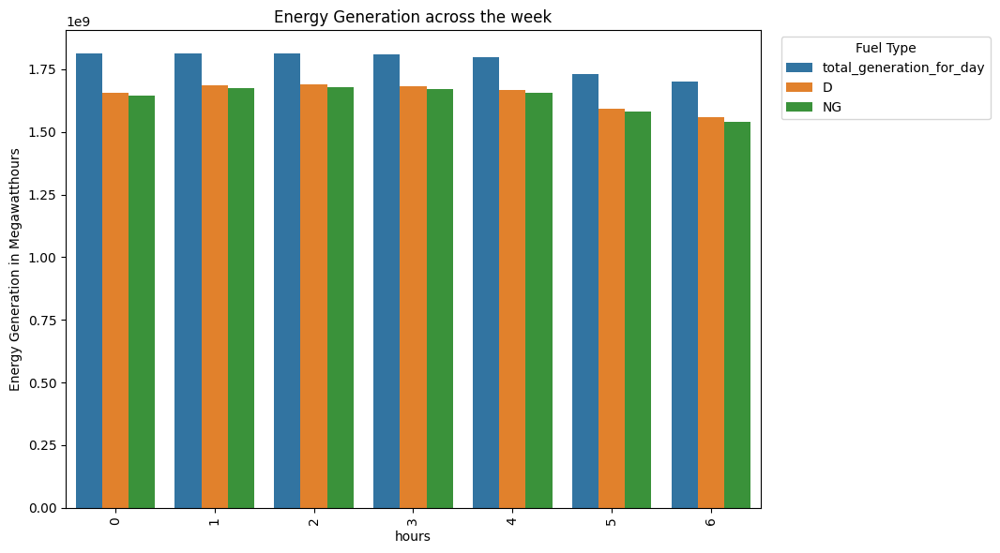
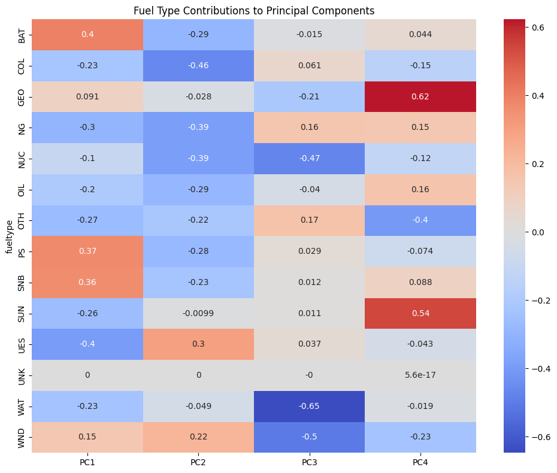

# ⚡ US Grid Energy Pipeline

An Airflow-orchestrated pipeline that loads hourly U.S. electricity data from the
EIA API into a Postgres warehouse, models it with SQL into analysis-ready marts,
and feeds a dashboard on generation mix, demand and forecast accuracy.


> **Dashboard:** _link coming soon (Tableau Public)_

## What it answers

1. **How clean is the grid, and when?** Renewable and clean (renewable + nuclear) share by region and month.
2. **When does each source run?** Average generation by local hour of day and season. For example, how much solar covers the evening demand peak.
3. **How good is EIA's day-ahead demand forecast?** Daily forecast error (MAPE) by region, and when it misses.
4. **Which regions depend most on natural gas and coal?**

_Findings and screenshots are added here once the full 2024 backfill has run._

## Architecture

```mermaid
flowchart LR
    API[EIA v2 API<br/>hourly fuel mix + demand] -->|paged, retried,<br/>incremental| L[load_generation<br/>load_region]
    subgraph Airflow DAG · daily
        I[init_warehouse] --> L --> Q[quality_checks] --> M[build_models] --> E[export_csv]
    end
    L -->|COPY + upsert| RAW[(raw)]
    RAW --> STG[(staging views)] --> MART[(mart tables)]
    M -.-> STG
    MART --> E --> CSV[CSV extracts] --> T[Tableau dashboard]
```

| Layer | Contents |
|---|---|
| `raw` | API rows as received, keyed on `(period, respondent, fueltype/type)` |
| `ref` | Fuel groupings (fossil / nuclear / renewable / storage) and region time zones |
| `staging` | Typed, enriched views; UTC converted to each region's local time; demand data pivoted from one row per metric to one row per hour |
| `mart` | `daily_fuel_mix`, `hourly_profile`, `daily_demand`, `monthly_summary`, `data_completeness` |
| `meta` | `load_log`: what every run fetched, accepted, de-duplicated and rejected |

## Engineering decisions

- **Incremental loads with a lookback.** Each daily run loads its own day plus the 3 days before it. EIA publishes late and revises recent hours, and the upsert picks up revised values. The original notebook re-downloaded the whole year in about 1.5 hours; a daily run fetches a few thousand rows.
- **Idempotent.** Loads are `COPY` into a temp table, then `INSERT … ON CONFLICT DO UPDATE`. Re-running any window gives the same result. Tests check this.
- **Stable pagination.** API pages are sorted on the full natural key, not just `period`. Otherwise rows with the same timestamp can shuffle between pages and get silently duplicated or dropped.
- **Correct time semantics.** EIA-930 timestamps are UTC and *hour-ending* (per the form instructions), so `15:00` covers 14:00–15:00. Staging converts to hour-beginning local time per region. Otherwise every hour-of-day chart is off by one and the hour ending at midnight lands in the wrong day.
- **No made-up values.** Missing hours stay `NULL`, and every mart reports `hours_reported` plus a completeness table. (An earlier version filled gaps with a global mean across all fuels, which put gas-plant values into solar series at night.)
- **Data quality checks as SQL.** Each file in `sql/checks/` returns the rows that violate a rule. `error` checks fail the DAG (implausible US-48 demand, timestamps in the future, empty loads). `warn` checks only log (fuel sum vs reported net generation).
- **Atomic model rebuilds.** Staging and marts rebuild in one transaction, so the dashboard never reads a half-built warehouse.
- **Airflow only orchestrates.** Tasks call plain Python functions in `src/eia_pipeline`, and data moves through Postgres rather than XCom. The same pipeline runs from the CLI and in tests without Airflow.

## Running it

Requirements: Docker and a free [EIA API key](https://www.eia.gov/opendata/).

```bash
cp .env.example .env        # add your EIA_API_KEY
make up                     # Airflow UI → http://localhost:8080
make backfill START=2024-01-01 END=2025-01-01   # one-off historical load
```

Then unpause `eia_grid_pipeline` in the Airflow UI to keep the data up to date daily.

| Command | |
|---|---|
| `make psql` | SQL shell on the warehouse (`localhost:5433`, user/pass `energy`) |
| `make models` / `make export` | Rebuild marts / write `exports/*.csv` |
| `make test` | Unit tests. Integration tests also run when `TEST_WAREHOUSE_DSN` points at a throwaway DB (`energy_test`). They wipe it. |
| `make down` | Stop the stack (data is kept in Docker volumes) |

Set `EIA_RESPONDENTS=US48,CAL,TEX,…` in `.env` to load only some regions for a faster, smaller backfill.

## Project layout

```
dags/eia_grid_pipeline.py   Airflow DAG: schedule, retries, task order
src/eia_pipeline/           extract · validate · warehouse · pipeline · CLI
sql/schema/                 raw, meta and reference tables
sql/models/                 staging views and mart tables
sql/checks/                 data quality rules
tests/                      unit tests + Postgres integration tests
notebooks/                  original exploratory analysis (PCA, time patterns)
```

## Exploratory analysis

The project started as a notebook analysis of 2024 hourly generation for a Big
Data Analytics course. That work, in `notebooks/`, motivated the marts above:

- `01_initial_exploration.ipynb`: summary statistics, time features, PCA and clustering of fuel sources
- `02_time_pattern_analysis.ipynb`: hourly, weekday, weekly and daily generation patterns, plus demand vs generation

| Monthly load & mix | Weekday load & mix | PCA loadings |
|---|---|---|
|  |  |  |

## Tech stack

Python · Apache Airflow 3 · PostgreSQL · SQL · psycopg · Docker Compose · pytest · GitHub Actions · Tableau

## Data source

[U.S. Energy Information Administration: Hourly Electric Grid Monitor](https://www.eia.gov/electricity/gridmonitor/)
(`electricity/rto/fuel-type-data` and `electricity/rto/region-data`). Timestamps are UTC.

## License

MIT, see [LICENCE.txt](LICENCE.txt).
